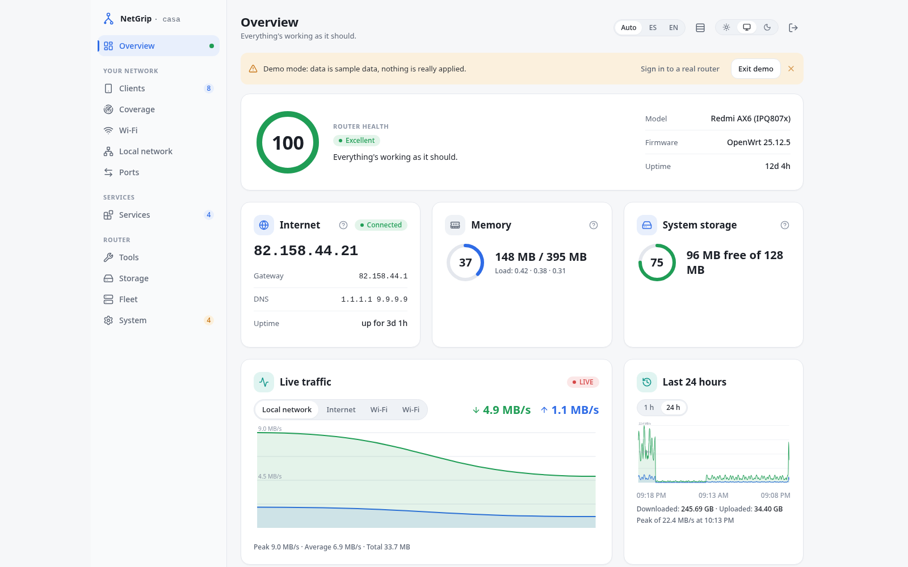
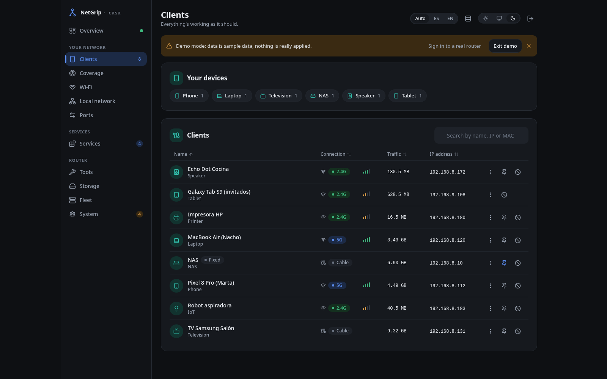
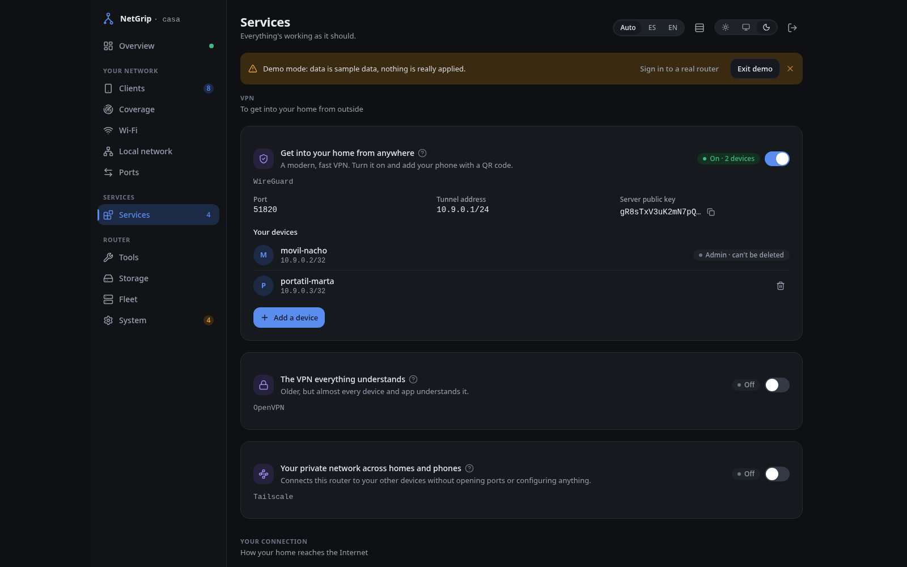
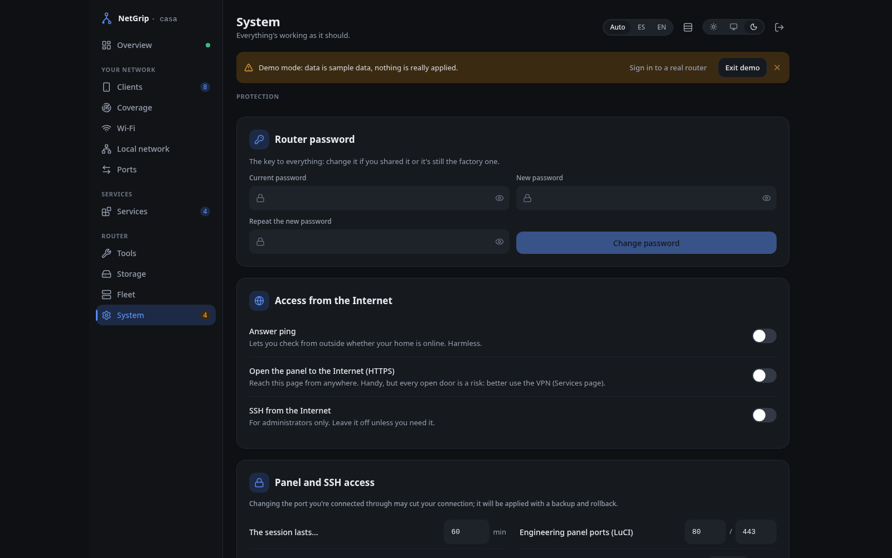

# NetGrip

<p align="center">
  <a href="README.md">English</a> |
  <a href="README.es.md">Español</a>
</p>

<p align="center">
  <a href="https://netgrip.cloudless.club"></a>
  <a href="https://demo.netgrip.cloudless.club"></a>
  <a href="https://github.com/gnacho/netgrip/releases"></a>
  <a href="LICENSE"></a>
  <a href="https://codecov.io/gh/gnacho/netgrip"></a>
</p>

<p align="center">
  <strong>Every service on your OpenWrt router, behind a switch your family
  can press.</strong><br>
  NetGrip is a companion panel that runs on the router itself, next to LuCI:
  WireGuard, guest Wi-Fi, QoS, DNS and more, one click each, with a snapshot,
  a health check and an automatic rollback if anything goes wrong.
</p>

<p align="center">
  <a href="https://demo.netgrip.cloudless.club"><strong>Try the live demo</strong></a> ·
  <a href="https://netgrip.cloudless.club"><strong>Visit the website</strong></a>
</p>

<p align="center">
  <picture>
    <source media="(prefers-color-scheme: dark)" srcset="assets/hero-en-dark.png">
    
  </picture>
</p>

## See it before you install it

- **[demo.netgrip.cloudless.club](https://demo.netgrip.cloudless.club)** runs
  the real panel on sample data: click every switch, open every card, nothing
  is applied anywhere.
- **[netgrip.cloudless.club](https://netgrip.cloudless.club)** lists
  **every single feature**, screen by screen, with the reasoning behind
  each one.

## Why NetGrip?

I kept handing OpenWrt routers to people who only want working Wi-Fi and a
VPN. LuCI is a tool for engineers: every toggle asks for a section name, an
interface and an option. Vendor portals are friendlier, but they are closed
apps that only work on that vendor's firmware. I wanted the machine in
between: the real router, behind buttons a relative can press. NetGrip takes
the services LuCI already exposes through rpcd and puts a switch in front of
each one. Flip it, and NetGrip snapshots the config, applies the change,
waits, checks the service came up, and undoes itself if it did not.

Four rules shape it:
- **It lives on the router.** One static Go binary with the UI embedded
  (12-15 MB on disk depending on architecture, and ~16-18 MB of RAM in
  use, measured on real routers), packaged as a real OpenWrt `.apk`/`.ipk`
  that survives sysupgrade. No container, no extra box, no Node on a
  router, and no LuCI: it serves its own UI and talks to OpenWrt's
  rpcd/ubus directly. Its extra packages are `ethtool-full` and
  `rpcd-mod-rpcsys`.
- **Safe by construction.** Every change goes through an allowlisted
  executor with a config snapshot and automatic rollback. The panel cannot
  wander off the beaten path.
- **It adapts to the device.** The same binary reads the box it runs on and
  shows only what applies there: a router, an access point or a managed
  switch each get the screens that make sense for them, and a feature that
  needs something the box does not have (a radio, an uplink, a package)
  simply stays out of the way.
- **No new accounts.** Login validates against rpcd, the same session LuCI
  uses; one admin per router, nothing extra to administer. AGPL-3.0, no
  premium anything.

## What you get

**An overview that answers "is everything fine?"** System health, WAN state
and a live traffic chart on one screen, plus an ethernet chassis with
per-port state, device names and unmanaged-switch detection. That is the
screenshot above.

**Clients you can actually manage.** Every station with speed and signal,
one-click reserved IPs, block actions and per-device bandwidth limits.

<p align="center">
  
</p>

**One card per service, each with a real switch.** WireGuard (peers with QR
codes) and OpenVPN (ready `.ovpn` downloads), DNS with rebind protection,
cake-based SQM with a bufferbloat grade, DDNS, guest and IoT Wi-Fi on their
own isolated subnets, port forwarding, and a router/AP mode switch that
moves the WAN role without editing `network` and `firewall` by hand.

<p align="center">
  
</p>

**System care without the ceremony.** Access and session settings, security
cards, a first-run wizard, self-updates (the panel upgrades itself in place,
no reinstall), firmware updates through owut/ASU that rebuild the image with
your packages inside, and the roaming mesh rendered as a radial graph via
usteer.

<p align="center">
  
</p>

**And more:** advanced traffic analysis by application (netifyd) with a 24 h
timeline, an optional `luci-app-netgrip` entry under LuCI > Services, and an
ES/EN interface that switches in one click. That is still not the whole
list: **[the website shows every feature](https://netgrip.cloudless.club)**,
each one with its screenshots at full size.

**A NetPulse agent built in.** The same binary also reports metrics, WiFi
events and clients to [NetPulse](https://netpulse.cloudless.club), so the
router shows up labeled as NetGrip in its fleet with no extra install. It is
a capability, not a requirement: if you do not use NetPulse, nothing changes.

**MQTT and Home Assistant, if you want them.** Optional and off by default:
point it at an MQTT broker and Home Assistant discovers the router on its own.
It publishes the state on `netgrip/<router>/state` and creates **23 entities**:
17 sensors (CPU, busiest core, temperature, memory, uptime, mode, version,
total/WiFi/wired/weak clients, weakest and average WiFi signal, and local
network in/out traffic), 4 switches (guest Wi-Fi, banIP, IPv6 and SQM) and
2 buttons (reload the banIP feeds and reboot). The switches and buttons act:
Home Assistant sends the command on `netgrip/<router>/command/...` and the
router replies on `netgrip/<router>/result`.

It is configured from the MQTT card on the System page, or by writing
`/etc/netgrip/mqtt.env` (mode 600). The card tests the connection before
saving, and a NetPulse server can push the broker settings to the router
(applied with the same snapshot-and-rollback as any other change). With TLS:
the certificate is checked against the system roots, with a checkbox to accept
a self-signed one. Nothing is published until you enable it.

**AI assistants (MCP), if you want them.** NetGrip can expose a local
[MCP](https://modelcontextprotocol.io/) endpoint so an AI assistant can query
the router's state in its own vocabulary. It is disabled by default, and the
first tool set is read-only:

1. Enable it and set a token:
   `uci set netgrip.mcp='mcp'; uci set netgrip.mcp.enabled=1; uci set netgrip.mcp.token=<long random>; uci commit netgrip`
   (the first command creates the section; a plain `uci set netgrip.mcp.enabled=1`
   on a fresh install fails with "Invalid argument").
2. Point your MCP client at `http://<router>:8080/mcp` (or whatever port the
   panel uses) and send the token as `Authorization: Bearer <token>`.

The endpoint never accepts the browser session cookie, answers 404 while
disabled, and is rate-limited per IP (60 requests/minute by default, tunable
with `uci set netgrip.mcp.rate_per_min=<n>`). The tools
(`server_status`, `list_clients`, `wireless_status`, `wan_status`,
`multiwan_status`, `list_leases`, `list_devices`) read the same probes and
caches as the panel, and every call is logged.

## Feature list

| Area | What you get |
| --- | --- |
| Overview | System health, WAN state, live traffic chart, per-port ethernet chassis, unmanaged-switch detection |
| Clients | Per-station speed and signal, reserved IPs, block, per-device bandwidth limits |
| LAN & DHCP | Reservations, range, lease time |
| IPv6 | Server / relay, announced DNS |
| Dual WAN | mwan3 policies and shares |
| Router / AP mode | Move the WAN role without editing network and firewall by hand |
| Wireless | SSID, WPA2/WPA3, channel and width, power, split or unify bands, hidden network |
| Guest & IoT Wi-Fi | Isolated subnets, one switch each |
| Mesh / roaming | Radial graph, 802.11r/k/v via usteer |
| VPN | WireGuard (server + client, QR peers) and OpenVPN (server + client, .ovpn downloads) |
| DNS | Rebind protection |
| QoS | SQM/cake with a bufferbloat grade |
| DDNS | Dynamic DNS updates |
| Port forwarding | DNAT redirects |
| UPnP | miniupnpd / NAT-PMP |
| Firewall | Traffic rules and zone policies |
| Parental controls | Per-device internet schedules |
| Traffic | Per-app analysis (netifyd), 24 h timeline |
| Usage history | Daily and monthly totals (vnstat + nlbwmon) |
| Protection | banIP feeds and AdGuard Home detection |
| USB storage | SMB (ksmbd or samba) + DLNA |
| First-run wizard | Guided setup |
| Self-update | In-place upgrade with verified binary signature |
| Firmware | owut/ASU rebuild with your packages inside |
| Safety | Config snapshots, automatic rollback, anti-lockout confirm timer |
| Backup | Download and restore the config |
| Administration | Access, session, security, password, scheduled reboot |
| Software | Package list via apk/opkg |
| Logs | System log |
| MQTT / Home Assistant | Discovery + 23 entities (sensors, switches, buttons) |
| NetPulse agent | Built-in fleet telemetry, optional |
| LuCI | Not required; optional luci-app-netgrip entry |
| MCP | Bearer-token endpoint with read-only tools for agents |
| Language | ES / EN |

## Get it on your router

Requirements: a supported amd64, ARM64, ARMv5/6/7, little-endian MIPS or
big-endian MIPS target running OpenWrt 24.10 or 25.12. The installer asks the
package manager for the router's exact package architecture, then selects the
matching package and generic Go ABI binary. The panel listens on port 8090 and
logs in with your LuCI credentials.

SSH into the router and run:

```sh
wget -qO- https://raw.githubusercontent.com/gnacho/netgrip/main/install.sh | sh
```

The script picks the right package for the router's architecture and package
manager (`apk` on OpenWrt 25.12+, `opkg` on 24.10), installs the latest
release, enables and starts the service, and prints the panel URL. Prefer to
review it first? Read [install.sh](install.sh). To pin a version:
`NETGRIP_VERSION=vX.Y.Z sh install.sh`.

Open `http://<router-ip>:8090` and log in with the same username and
password you use for LuCI.

<details>
<summary><strong>Manual install (packages)</strong></summary>

Download the right package from the
[releases](https://github.com/gnacho/netgrip/releases/latest) page and, on
the router:

```sh
# OpenWrt 25.12 (apk; suffix is the exact OpenWrt package architecture)
apk add netgrip-<version>-r1-aarch64_cortex-a53.apk

# OpenWrt 24.10 (ipk; suffix is the exact OpenWrt package architecture)
opkg install netgrip_<version>-1_aarch64_cortex-a53.ipk

/etc/init.d/netgrip enable && /etc/init.d/netgrip start
```

The postinst adds the binary, the init script and the rc.d link to
`/etc/sysupgrade.conf`, so the panel comes back after a firmware update. The
optional `luci-app-netgrip` package embeds the panel under LuCI > Services
in the same way.

</details>

<details>
<summary><strong>Manual install (bare binary) and build from source</strong></summary>

A bare binary works but dies on every firmware update; the package is the
recommended path.

```sh
# Busybox dropbear has no scp; pipe the file instead:
cat netgrip-linux-arm64 | ssh root@<router-ip> "cat > /usr/sbin/netgrip && chmod 755 /usr/sbin/netgrip"
/usr/sbin/netgrip -listen 0.0.0.0 -port 8090
```

Building from source requires Go 1.24+ and Node 22+:

```sh
git clone https://github.com/gnacho/netgrip.git
cd netgrip
cd app && npm ci && npm run build && cd ..
VERSION=dev sh deploy/build-binaries.sh
```

That command builds the frontend once and emits generic binaries for amd64,
ARM64, ARMv5/6/7, mipsle and mips in `dist/`. Pass one or more target names,
such as `linux-armv7` or `linux-mipsle`, to build only those binaries.

</details>

<details>
<summary><strong>Power-user reference: flags, service and JSON API</strong></summary>

Flags (defaults are what most routers want):

| Flag | Default | Description |
| --- | --- | --- |
| `-listen` | `0.0.0.0` | Address to bind. |
| `-port` | `8090` | Port to listen on. GL.iNet firmware serves its own web UI on 8080, hence the default. |
| `-rpcd-url` | `http://127.0.0.1/ubus` | rpcd JSON-RPC endpoint for login validation. |

The session timeout changes from the UI's Access card
(`options.main.session_timeout` in UCI). The service runs from procd:

```sh
/etc/init.d/netgrip status
logread -e netgrip -f
/etc/init.d/netgrip restart
```

There is a JSON API behind every card, used by the frontend: reads via
`GET /api/board`, `/api/system`, `/api/wan`, `/api/wifi`, `/api/lan`,
`/api/dns`, `/api/usteer`, `/api/clients`, `/api/netifyd`, `/api/dpi/apps`,
`/api/dpi/timeline` and `/api/nftqos`; writes via the matching `POST`
endpoints (`/api/wireguard`, `/api/openvpn`, `/api/sqm`, `/api/guestwifi`,
`/api/iotwifi`, `/api/portforward`, `/api/netifyd`, `/api/nftqos`) with a
`{ "state": ..., "rolled_back": ..., "status": "applied|rolled_back|failed" }`
shape. Every write requires a session cookie.

</details>

## What's next

Done recently: MQTT and Home Assistant integration (state, sensors and
switches/buttons that act, auto-discovered), seven generic Go ABIs per
release from amd64 to MIPS, and a bilingual UI whose document language
follows the active language. Coming next:
a custom packages feed so owut/ASU can keep NetGrip
inside your firmware image ([#63](https://github.com/gnacho/netgrip/issues/63)),
and keeping the public demo in step with the panel. Ideas and reports in the
[issues](https://github.com/gnacho/netgrip/issues) steer what gets built.

## Development

Stack: Go (single static binary) + React 19 + TypeScript + Vite + Tailwind,
embedded with `go:embed`. No external database.

```sh
cd app && npm ci
npm run dev      # frontend dev server (see vite.config.ts for the /api proxy)
go build -o netgrip ./cmd/netgrip
go test ./...
```

On every release tag, CI builds and precompresses the frontend once,
cross-compiles seven generic Go ABI binaries, and fans those binaries out into
target-specific `.apk`/`.ipk` packages with the OpenWrt SDK. The release summary
reports the size of every binary and the compressed frontend.

Binary size (release assets, UI embedded):

| Architecture | Size (approx) |
| --- | ---: |
| arm64 | 12.7 MB |
| amd64 | 13.8 MB |
| armv5 / armv6 | 13.4 MB |
| armv7 | 13.3 MB |
| mips / mipsle | 15.1 MB |

Runtime memory use is ~16-18 MB RSS.

The 12-15 MB is the whole autonomous daemon, not the UI. It is the Go
runtime plus the backend (ubus/rpcd client, probes, MQTT, the NetPulse
agent, self-update) plus the embedded frontend. The frontend itself is
~344 KB gzipped; the rest is what lets NetGrip run standalone where a
pure UI layer (like LuCI) is a few hundred KB on top of services OpenWrt
already ships.

## License

AGPL-3.0-only. See [LICENSE](LICENSE).

Built by gnacho as a personal self-hosted project. If NetGrip is useful to
you, a star on GitHub is the way to say thanks; issues and PRs are welcome.
